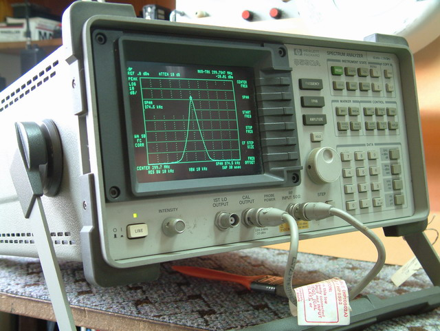

# hp8590A

Research and development with the Hewlett-Packard 8590A spectrum analyzer.

## HP 8590A overview

The HP 8590A is a compact, portable RF spectrum analyzer for general-purpose
signal measurement and troubleshooting. Its standard frequency range is
10 kHz to 1.5 GHz, with resolution bandwidths from 1 kHz to 3 MHz and a
calibrated amplitude range of approximately -115 dBm to +30 dBm under the
specified measurement conditions. It has a 50-ohm BNC RF input, CRT display,
and front-panel soft keys for frequency, span, amplitude, markers, and trace
control.

It is useful for examining transmitters, oscillators, filters, interference,
harmonics, and other RF signals.

### Installed options

- **Option 021 — HP-IB interface.** Adds Hewlett-Packard Interface Bus
  (HP-IB), HP's implementation of IEEE-488/GPIB. This supports remote control,
  automated measurements, trace/data transfer, and integration with a computer
  or automated test system.
- **Option H18 — 1.79 GHz frequency extension.** Extends the specified upper
  frequency limit from 1.5 GHz to 1.79 GHz, covering more of the upper UHF and
  L-band range.
- **Option H51 — Close-Field EMC Analyzer.** Adds EMC-oriented functions for
  locating electromagnetic-interference hot spots during design and debugging.
  It is intended for use with the HP 11945A close-field probe set, comprising
  the 11941A (9 kHz to 30 MHz) and 11940A (30 MHz to 1 GHz) magnetic-field
  probes. It adds an EMC personality, EMC bandwidths, and an N-type input
  connector. H51 displays field strength at the probe tip in dBµA/m while
  applying probe factors. It also provides 9 kHz and 120 kHz resolution
  bandwidths for impulsive-interference measurements, plus a MIN/MAX function
  to help distinguish narrowband signals from broadband or impulsive noise.

Together, these options make this instrument suitable for remotely controlled
RF troubleshooting and close-field EMI investigation up to 1.79 GHz.

## Local manuals

### Analyzer

- [Installation Manual](manuals/08590-90003.pdf) — initial installation,
  instrument configuration, basic specifications, and option descriptions.
- [Operating Manual](manuals/08590-90005.pdf) — front-panel operation,
  measurements, analyzer functions, and programming commands.
- [Service Guide](manuals/08590-90109.pdf) — troubleshooting, adjustment,
  repair, and replaceable-part information.
- [Installation and Verification Manual](manuals/08590-90131.pdf) — the later
  installation/verification revision; use it for functional checks and
  performance-verification procedures.

### Close-field EMC probes

These documents support the HP 11945A close-field probe set used with Option
H51.

- [11941A Operation Note](probes/11941-90001.pdf) — operation, test setups,
  and applications for the 9 kHz to 30 MHz close-field probe. In particular,
  it describes using the probe to localize emissions and for susceptibility and
  shielding investigations.
- [11940A Operation Note](probes/11940-90001.pdf) — operation and applications
  for the 30 MHz to 1 GHz close-field probe.
- [Typical EMC Transducer Factors](probes/9018-06482.pdf) — typical correction
  factors for EMC accessories. Page 1 provides correction-factor tables for
  both the 11940A and 11941A; consult these when making manual field-strength
  conversions.

### H51 option references

- [HP 1989 Catalog](HP-Catalog-1989.pdf), PDF page 138 (catalog page 133),
  **“HP 8590A Option H51 Close-Field EMC Analyzer.”** This is the primary H51
  product description: it identifies the EMC personality, special EMI
  bandwidths, automatic analysis routines, N-type input, and compatibility
  with the 11945A probe set. The same page summarizes the 11940A and 11941A
  probes, their frequency ranges, and the included cables and adapters.
- [HP Test & Measurement News, September/October 1987](HP-Test-Measurement-Sept-Oct-1987.pdf),
  page 8, **“Spectrum analyzer, probes help solve EMC problems.”** This
  contemporary application article explains the practical H51 workflow:
  locating an emissions hot spot, displaying probe-tip field strength in
  dBµA/m, applying probe factors, using 9 kHz/120 kHz EMI bandwidths and
  MIN/MAX, improving frequency readout accuracy from a reference signal, and
  comparing saved traces before and after an EMC fix.
